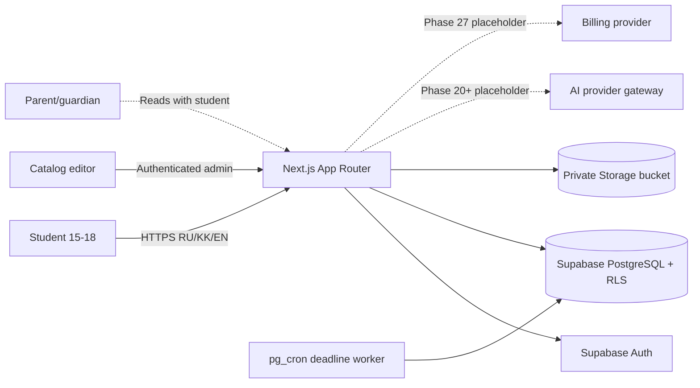
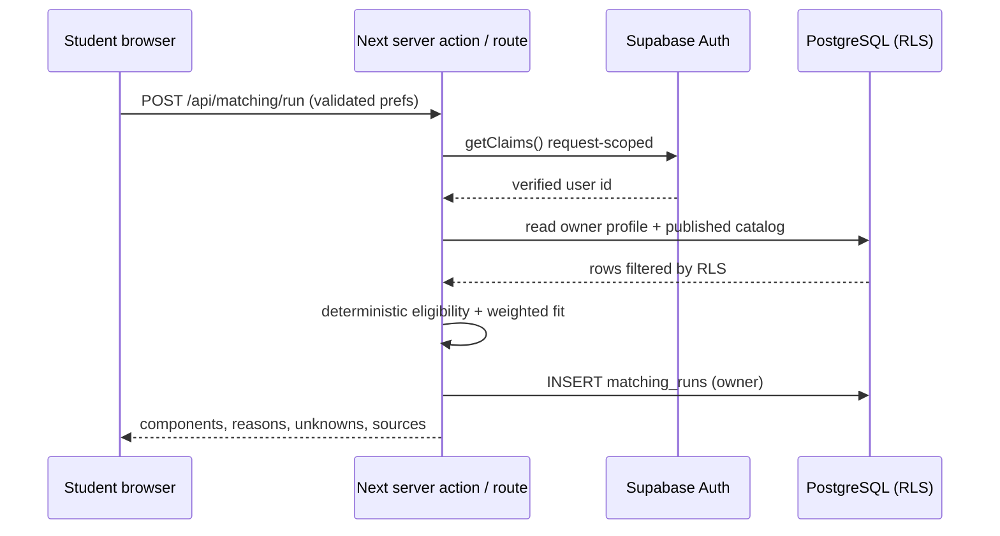
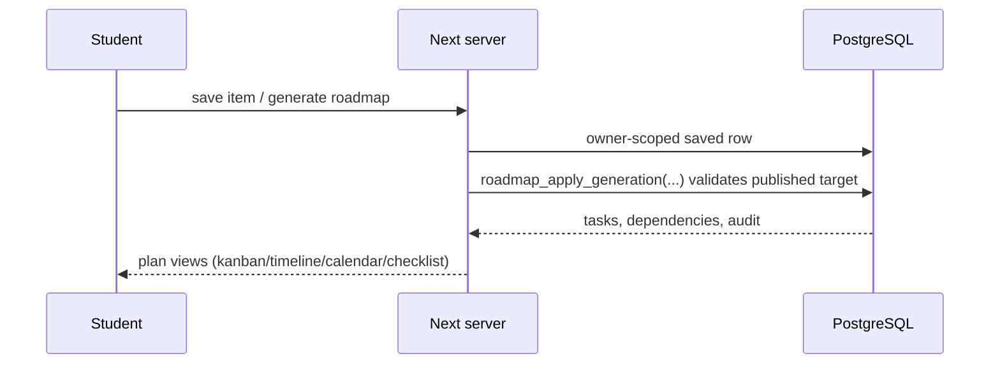
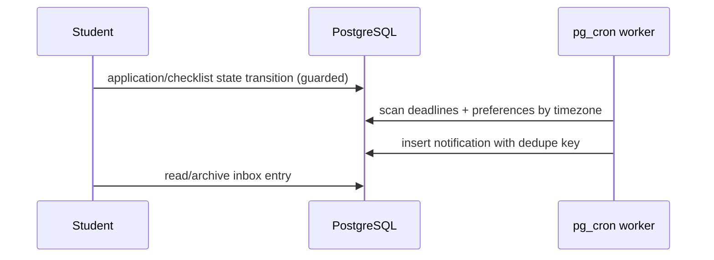

# Phase 03 — Architecture, domain boundaries and ADR index

**Date:** 2026-11-18
**Supersedes:** empty pre-Phase-04 architecture artifacts (none existed).
**Companion docs:** `docs/ARCHITECTURE.md` (implementation map),
`docs/DECISIONS.md` (dated decisions), `docs/DATABASE_SCHEMA.md`,
`docs/RLS_MATRIX.md`.

The system is a **modular monolith**: one Next.js deployment, one managed
PostgreSQL (Supabase), explicit domain folders, SQL-first state, no
microservices. This matches MVP cost and operational constraints.

## 1. C4 context

Trust boundary: browser ↔ Next server is untrusted input; Next server ↔ database
uses request-scoped authenticated clients or a server-only secret for explicitly
authorized operations. The `service_role` key never reaches the browser bundle.

## 2. Container and domain map

| Domain        | Code                                                               | Tables (owner)                                                                  | Write path                                   | Read path                                           | Failure strategy                      |
| ------------- | ------------------------------------------------------------------ | ------------------------------------------------------------------------------- | -------------------------------------------- | --------------------------------------------------- | ------------------------------------- |
| identity      | `src/app/(auth)`, `src/lib/supabase`                               | `auth.users` (Supabase)                                                         | Server actions + PKCE callback               | Session claims refreshed in `src/proxy.ts`          | Fail closed: misconfigured env denies |
| profile       | `src/features/onboarding`, `src/features/privacy`                  | `student_profiles`, `student_profiles_versions`, attachments, deletion requests | Owner-scoped server actions, version trigger | Owner SELECT                                        | Error states; no silent overwrite     |
| catalog       | `src/features/catalog`, `src/features/search`                      | catalog entities + views + `unified_catalog_search`                             | Editorial console (admin) only               | Public RPC honoring published/verified/source gates | Degraded "unavailable" UI             |
| funding       | `src/features/catalog` (scholarship scope)                         | scholarship tables + benefits + deadlines                                       | Editorial console                            | Public RPC                                          | Same as catalog                       |
| matching      | `src/features/matching`, `/api/matching/run`                       | `matching_runs` (owner)                                                         | Authenticated API, rate-limited              | Owner SELECT                                        | Deterministic recompute               |
| planner       | `src/features/roadmap`, `/api/roadmaps`                            | roadmap targets/tasks/dependencies                                              | Owner API + generator function               | Owner SELECT                                        | Manual tasks preserved                |
| applications  | `src/features/applications`, `/api/applications`                   | applications, checklist, events                                                 | Owner API with state-machine guards          | Owner SELECT                                        | Append-only audit                     |
| documents     | `src/features/vault`, `/api/vault`                                 | vault documents/versions + Storage objects                                      | Owner upload with MIME/size checks           | Signed/authorized reads                             | Quarantine/retention                  |
| writing       | `src/features/writing`, `/api/writing`                             | writing drafts/versions                                                         | Owner API                                    | Owner SELECT                                        | Version history                       |
| deadlines     | `src/features/deadlines`, `/api/deadlines`, `/api/calendar/export` | deadlines, subscriptions, notifications, preferences                            | Cron worker + owner prefs                    | Owner inbox, ICS                                    | Deduped delivery                      |
| admin         | `src/features/catalog-editor`, `/api/admin/*`                      | memberships, source claims, review events                                       | Membership-gated server actions              | Editor/reviewer roles                               | Deny-all default                      |
| mentoring     | not implemented                                                    | —                                                                               | —                                            | —                                                   | Phase 22                              |
| organizations | not implemented                                                    | —                                                                               | —                                            | —                                                   | Phase 26                              |
| billing       | not implemented                                                    | —                                                                               | —                                            | —                                                   | Phase 27                              |
| ai            | not implemented                                                    | —                                                                               | —                                            | —                                                   | Phase 20/21                           |

## 3. Ownership rules

1. **Public catalog read** is unauthenticated only through SECURITY INVOKER RPCs
   whose underlying RLS enforces published + verified + active source claims.
2. **Private workspace** rows carry `user_id = auth.uid()`; four-policy owner
   model (SELECT/INSERT/UPDATE/DELETE) with explicit grants. No editable role
   metadata is trusted for authorization.
3. **Editorial authority** comes from `catalog_editor_memberships` rows tied to
   `auth.uid()`; commands require revision/hash checks and emit append-only audit
   events.
4. **Server-only secret** is used only by trusted server operations (roadmap
   generation authority, scheduled worker) with explicit `service_role` grants.

## 4. Key sequences

### 4.1 Profile → match

### 4.2 Save → plan

### 4.3 Application → reminder

## 5. Transactions, idempotency, caching

- Multi-step catalog publication and roadmap generation run inside SQL functions
  with advisory locks; client retries are safe because commands carry revision
  and hash preconditions.
- Deadline notifications use a unique `user+event+scheduled_time+channel` dedupe
  constraint; repeated worker runs do not duplicate.
- Catalog reads use request-scoped clients; no shared response cache; `no-store`
  on authenticated responses. Public pages rely on Next SSR each request.
- Saved writes are idempotent by unique key; conflicting concurrent writes resolve
  to one row.

## 6. ADR index (existing decisions)

| ADR | Decision                                                                 | File                                                     |
| --- | ------------------------------------------------------------------------ | -------------------------------------------------------- |
| A1  | Modular monolith + SQL-first state                                       | this doc + `ARCHITECTURE.md`                             |
| A2  | RLS-first authorization with explicit grants                             | `docs/RLS_MATRIX.md`, Phase 04 section of `DECISIONS.md` |
| A3  | Server-rendered localized routes, request-scoped Supabase clients        | Phase 04/12 decisions                                    |
| A4  | Deterministic matching; no admission-probability claims                  | Phase 16 decisions + `AI_MATCHING_ARCHITECTURE.md`       |
| A5  | Editorial publication requires reviewed source claims                    | Phase 11/28 docs                                         |
| A6  | Private storage bucket, owner paths, MIME/size checks                    | `DOCUMENT_SECURITY_MATRIX.md`                            |
| A7  | Deadline delivery via DB + cron with dedupe, no client timers            | `DEADLINE_ENGINE.md`                                     |
| A8  | AI provider optional and server-side; unconfigured = visibly unavailable | Phases 20/21 scope                                       |

## 7. Staging, observability, failure strategy

- Environments: local → authorized development project → preview → production
  (production not authorized). Credentials are per-environment; no destructive
  remote reset.
- Observability: request IDs and sanitized errors in `src/server/http.ts`; no PII
  in logs; worker delivery status is queryable for admin metrics.
- Failure strategy: public catalog degrades to explicit unavailable states;
  private writes fail closed; AI/billing/mentoring features are hidden until
  configured.

## 8. Exit-test statement

Every table has a named owner domain, an authorization model, a write path, a
read path and a failure mode. No record depends on a hidden admin key in the
browser. Remaining domains (ai, mentoring, organizations, billing) are explicitly
unimplemented and hidden from navigation.
